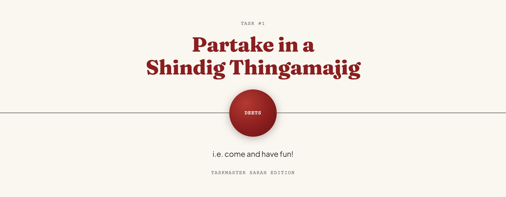

## About

Help plan shindig thingamjigs with friends.

tho also an excuse to try out "agentic orchestration"

Live: [shindig-thingamajig.netlify.app](https://shindig-thingamajig.netlify.app/)

# Dev

0. install 11ty: `npm install -g @11ty/eleventy`
1. [optional] build site: `npx @11ty/eleventy`
2. start local server: `eleventy --serve`

Hosted on netlify, built with eleventy, minimal css/js. google form really doing the heavy lifting cause i opted to not create a db and form inputs lulz

## License

[MIT](LICENSE).
